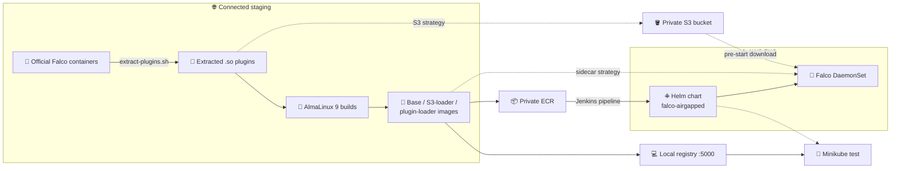

# 🦅 Falco Air-Gapped Deployment Project

A complete solution for deploying Falco, the cloud-native runtime
security tool, in air-gapped environments with no internet access:
custom AlmaLinux 9 images, a private ECR registry, plugins delivered
without public registries, local testing on Windows 11/macOS, and a
Jenkins-driven production deployment on AWS EKS.

## 📑 Table of Contents

- [🎯 Start here](#-start-here)
- [⚙️ How it works](#️-how-it-works)
- [🏗️ Architecture](#️-architecture)
- [🗂️ Directory structure](#️-directory-structure)
- [📋 Prerequisites](#-prerequisites)

## 🎯 Start here

| If you want to… | Read |
|---|---|
| Get Falco running fast (≈30 min) | [QUICKSTART.md](./QUICKSTART.md) — fast path for local testing and first deployment |
| Understand the project before touching anything | [PROJECT_OVERVIEW.md](./PROJECT_OVERVIEW.md) — executive summary, design decisions, scope |
| Test locally with Docker Desktop + Minikube | [docs/README_LOCAL.md](./docs/README_LOCAL.md) — step-by-step local setup and testing guide |
| Deploy to production AWS EKS via Jenkins | [docs/README_PROD.md](./docs/README_PROD.md) — production prerequisites and pipeline deployment |
| Look up image/plugin/chart internals | [TECHNICAL_REFERENCE.md](./TECHNICAL_REFERENCE.md) — container images, plugin loading strategies, configuration reference |
| Stage a fully offline release from upstream binaries | [airgapped-releases/README.md](./airgapped-releases/README.md) — download upstream artifacts, publish GitHub releases, build images from them |

## ⚙️ How it works

1. **Extract plugin artifacts.** The official Falco plugin containers are
   pulled in an internet-connected environment and the compiled `.so`
   files (`container`, `audit-eks`) are extracted — no source builds,
   no cmake toolchain. Artifacts live in a private repo or S3 bucket.
2. **Build custom images.** Falco images are built on `almalinux:9` and
   wired to load plugins from a sidecar or S3 instead of downloading
   them at runtime. Everything is pushed to a private ECR registry.
3. **Deploy with a flexible Helm chart.** One values switch selects the
   plugin strategy: `sidecar` (init container provides the plugins) or
   `s3` (Falco pulls plugins from a private bucket on startup).
4. **Automate with Jenkins.** The provided `Jenkinsfile` runs the whole
   chain — extract plugins, build images, deploy to EKS.

## 🏗️ Architecture

Falco runs with no runtime internet dependency: plugins are extracted once in a connected staging environment, baked into AlmaLinux 9 images, and distributed through a private ECR registry. One Helm chart deploys the Falco DaemonSet to EKS, and a values switch chooses how plugins reach the pod — a plugin-loader init container (sidecar strategy) or a pre-start download from a private S3 bucket (S3 strategy).



**Components**

- **Plugin extraction** (`scripts/local/extract-plugins.sh`, `plugins/`) — pulls the official Falco plugin containers and extracts the compiled `container` and `k8saudit-eks` `.so` files; no cmake or source builds.
- **Custom images** (`docker/base/`, `docker/plugin-loader/`) — the Falco base image, an S3-loader variant with the AWS CLI, and the plugin-loader sidecar image, all on AlmaLinux 9.
- **Helm chart** (`helm/falco-airgapped/`) — DaemonSet, ConfigMap, RBAC, and Service templates; `values.yaml` selects the `sidecar` or `s3` plugin strategy.
- **Jenkins pipeline** (`jenkins/Jenkinsfile`) — orchestrates plugin extraction, optional S3 upload, parallel image builds, ECR push, and Helm deployment to EKS, parameterized per environment.
- **Local path** (`scripts/local/`, `docs/README_LOCAL.md`) — the same images are pushed to a local registry (`localhost:5000`) and the same chart deploys to Minikube for offline testing.

## 🗂️ Directory structure

```
falco-airgapped-deployment/
├── docker/                  # Dockerfiles for custom images
│   ├── base/                # Falco base image (AlmaLinux 9)
│   └── plugin-loader/       # Plugin loader sidecar image
├── helm/falco-airgapped/    # Helm chart (sidecar | s3 plugin strategy)
├── jenkins/                 # Jenkins pipeline and agent configuration
├── plugins/                 # Falco plugin artifacts
│   ├── extracted/           # Extracted .so plugin files
│   └── source/              # Plugin sources (if built from source)
├── scripts/                 # Build and deployment scripts
│   ├── local/               # Local testing
│   └── aws/                 # AWS deployment
├── airgapped-releases/      # Offline release staging (see its README)
└── docs/
    ├── README_LOCAL.md      # Local setup and testing guide
    └── README_PROD.md       # Production deployment guide (AWS EKS)
```

## 📋 Prerequisites

- **Local testing:** Docker Desktop, Minikube, `kubectl`, `helm`
- **Production:** AWS account, EKS cluster, ECR registry, Jenkins server
  with a configured agent; an S3 bucket if using the `s3` plugin strategy

Per-guide prerequisites and step-by-step instructions are in the
documents linked above.
